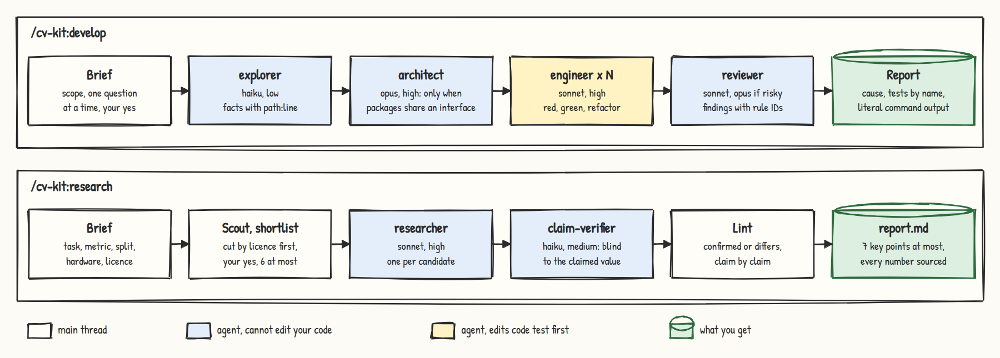
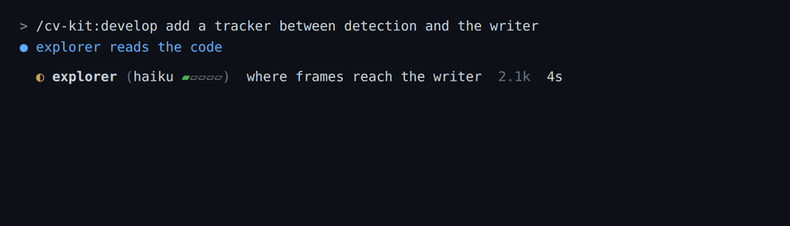

# cv-kit

[](https://github.com/lthphuw/cv-kit/actions/workflows/validate.yml)
[](LICENSE)

A Claude Code plugin for computer-vision engineers who write Python, edge C++ and Go. One prompt gives you tested
code, sourced model research, a strict review or a clean commit, with each step handed to the cheapest agent that
can do it.



## Install

```
/plugin marketplace add lthphuw/cv-kit
/plugin install cv-kit@cv-kit
/cv-kit:setup python                  # once per project: python | cpp | both

/plugin marketplace update cv-kit     # update
/reload-plugins
```

Needs Claude Code ≥ 2.1.295 and `python3`. `figure` also needs Python ≥ 3.10 and Chrome or Chromium (`CHROME=` if not
on PATH; not the snap build, it cannot read `/tmp`).

## Skills

Name a skill, or describe the work: "NMS crashes on empty input" loads `develop`.

| Kind | Name | Example prompt | You get |
|:-----|:-----|:---------------|:--------|
| Skill | `develop` | `NMS in src/post/nms.cc crashes on zero detections` | failing test → fix → literal `ctest` output |
| Skill | `research` | `which detector for 30 FPS on Orin NX, Apache-2.0` | short report, every number re-checked against its source |
| Skill | `review` | `train/val split in data/split.py, any leakage?` | `[Severity] RULE-ID path:line` findings → `Blocking: N Critical, M Major` |
| Skill | `figure` | `low-level figure with tensor shapes for the neck and head` | hand-drawn HTML + PNG (SVG for papers), like the one above |
| Skill | `commit` | `/cv-kit:commit` | preview → your yes → git or SVN commit without AI trailers |
| Skill | `setup` | `/cv-kit:setup cpp` | `.claude/rules/` + lint configs, existing files kept |

## Agents

You never pick an agent: the skill does, and sizes the model and effort to the task.

| Kind | Name | Model · effort | Job |
|:-----|:-----|:---------------|:----|
| Agent | `explorer` | haiku `▰▱▱▱▱` | find and summarise code, logs, docs · read-only |
| Agent | `architect` | opus `▰▰▰▱▱` · public API, threading: `▰▰▰▰▱` | options, flow, interfaces, work packages · read-only |
| Agent | `engineer` | sonnet `▰▰▰▱▱` · mechanical: `▰▰▱▱▱` · hard: opus `▰▰▰▱▱` | one change, test first, from a full brief |
| Agent | `reviewer` | sonnet `▰▰▰▱▱` · risky or designed: opus `▰▰▰▱▱` | findings with rule IDs · read-only |
| Agent | `researcher` | sonnet `▰▰▰▱▱` | sourced evidence for one candidate model |
| Agent | `claim-verifier` | haiku `▰▰▱▱▱` | re-reads one candidate's sources, blind to the claimed value |

Effort: `▰▱▱▱▱` low · `▰▰▱▱▱` medium · `▰▰▰▱▱` high · `▰▰▰▰▱` xhigh

- **Sonnet by default.** Opus only for a concurrency or memory-safety bug, a cause still unknown after a
  reproduction attempt, a design, and the review of those.
- **Design first, only when it pays.** Work that splits into packages sharing an interface or a data flow goes to
  `architect`; you approve the design before any engineer starts.
- **A brief, not a chat.** Every engineer gets `Goal · Done when · Facts · Files · Constraints · Ruled out · Mode`.
- **Re-brief before escalating.** Failed on the brief: fix it, same model. Failed on the reasoning: sonnet → opus →
  opus `▰▰▰▰▱` once, then a report. At most three attempts.

## Flows

### `/cv-kit:develop`

```
/cv-kit:develop add a tracker between detection and the writer
  │
  ├─ 1 SIZE ──── one-liner? ─┬─ yes ─► do it inline ─► 5
  │                          └─ no ──► one question at a time ─► brief ─► your yes
  ├─ 2 LOOK ──── project rules · test setup · baseline test run         explorer
  ├─ 3 DESIGN ── only when packages share an interface or a data flow   architect
  │              options · flow · interfaces · packages ─► your yes
  ├─ 4 BUILD ─── red ─► green ─► refactor, one brief per package        engineer × N
  │              independent packages in parallel, each in a worktree
  ├─ 5 VERIFY ── tests + linters ─► review of the pasted diff           reviewer
  └─ 6 REPORT ── cause at path:line · tests by name · literal command output
```

### Who gets the work

```
task ─┬─ find · read · summarise ───────────────► explorer  haiku  ▰▱▱▱▱
      ├─ rename · config · pinned behaviour ────► engineer  sonnet ▰▰▱▱▱
      ├─ known spec · bug a test reproduces ────► engineer  sonnet ▰▰▰▱▱ ─► reviewer sonnet ▰▰▰▱▱
      ├─ packages share an interface or flow ───► architect opus   ▰▰▰▱▱ ─► your yes
      │                                           ─► engineers sonnet ▰▰▰▱▱ ─► reviewer opus ▰▰▰▱▱
      └─ threads · memory · cause unknown ──────► engineer  opus   ▰▰▰▱▱ ─► reviewer opus   ▰▰▰▱▱

came back blocked?   ──► answer it, continue the same agent
failed on the brief? ──► fix the brief, same model
failed on reasoning? ──► sonnet ▰▰▰▱▱ ──► opus ▰▰▰▱▱ ──► opus ▰▰▰▰▱ once ──► report
```

### `/cv-kit:research`

```
/cv-kit:research which detector for 30 FPS on a Jetson Orin NX, Apache-2.0 only
  │
  ├─ 1 FRAME ──────── brief.md: task · metric · split · hardware · latency · licence
  ├─ 2 SCOUT ──────── arXiv · HF Papers · CVF · GitHub ─► one line per candidate
  ├─ 3 SHORTLIST ──── cut by licence ─► task ─► weights ─► traceable numbers ─► your yes (≤ 6)
  ├─ 4 DEEP-READ ──── researcher A   researcher B   researcher C       one per candidate, in parallel
  ├─ 5 CROSS-CHECK ── verifier A     verifier B     verifier C         blind to the claimed values
  │                   lint: confirmed | differs | wrong-paper | absent | unreachable
  └─ 6 REPORT ─────── report.md (overview · ≤ 7 points · table) + appendix.md (ledger · sources)

one claim to check? ─► steps 4–5 only ─► confirmed | partly right | contradicted | not found
```

### `/cv-kit:review` and `/cv-kit:commit`

```
review   scope ─► installed linters and tests ─► reviewer reads the pasted diff ─► findings
         [Critical] CPP-ERR-8 src/infer/engine.cc:88 ─► What · Trigger · Fix
         Blocking: 1 Critical, 0 Major ─► fixes only after your yes

commit   branch + files + message ─► STOP ─► your yes ─► git / svn commit
                                                              ▲
                                      block_trailers.py ──────┘  refuses AI trailers
```

## What you see



One live row per agent, rendered here from `hooks/agent_status.py` output: `icon agent (model effort) task tokens
elapsed`, with `◐` running, `○` stalled, `✓` done, `✗` failed, `■` killed. When an agent finishes you get a
`Progress` line per agent; a finished task ends with `Summarization` (results with their evidence) and `Next`
(prompts to paste).

## Unattended runs

`/goal <condition>` runs until a judge model says the condition holds; `/loop [interval] <prompt>` repeats. Use auto
mode.

```
/goal follow /cv-kit:develop. clamp_boxes in vision/utils.py clips xyxy boxes and drops empty ones; a new pytest test failed first, then `pytest -q` exits 0 and `ruff check .` is clean. Then /cv-kit:review the diff against main until it ends with `Blocking: 0 Critical, 0 Major`. Print each output. Or stop after 25 turns.
```

```
/loop 15m first run `test -f .cv-kit-stop` and stop if it exists; otherwise /cv-kit:review the diff against main, report only new Critical or Major findings, change nothing
```

- Nothing is committed or pushed unless the condition says so, and `/cv-kit:commit` still shows its preview.
- With the `permissions.ask` rules from `/cv-kit:setup`, `git commit`, `git push` and `gh pr create` still prompt.
- Two failed fixes stop the run with the evidence; `touch .cv-kit-stop` halts the loop above.

Draft one with `/cv-kit:develop write the /goal line for the NMS crash`. Templates:
`skills/develop/references/goal-loop-templates.md`.

## Hooks

| Hook | Runs | Does |
|:-----|:-----|:-----|
| `concise.py` | session and agent start | short replies; the `Progress`, `Summarization` and `Next` blocks |
| `block_trailers.py` | before each Bash call | refuses a commit that carries an AI trailer |
| `evidence_gate.py` | after edits and Bash, at stop | code changed after the last green test: holds the turn, once |
| `agent_status.py` | status line | the live agent rows |

Details and known gaps: `hooks/README.md`.

## Configuration

| What | Where | How |
|:-----|:------|:----|
| Rules, lint configs | `/cv-kit:setup` | never overwrites; refresh: `python3 scripts/install_rules.py <project> --force` |
| Models | `model:` in `agents/*.md` | aliases `haiku` `sonnet` `opus`, or a full model ID to pin |
| Concise mode, Progress, Next | `hooks/hooks.json` | remove the two `concise.py` entries to turn off |
| Evidence ledger | `~/.cache/cv-kit/gate/` | move with `CV_KIT_GATE_DIR` |
| Live rows | plugin `settings.json` | your own `subagentStatusLine` wins; `NO_COLOR=1` drops colour |

Lint configs tested with ruff 0.17.2, mypy 2.4.0, clang-format and clang-tidy 23.1.3, CMake 4.4, GCC 13.3.

## Limitations

- Evidence gate: a nudge, it cannot tell the right tests ran.
- Commit hook: gaps such as `--amend --no-edit` and `bash -c` (`hooks/README.md`).
- Live rows: need the SessionStart hook; off in untrusted folders and under `disableAllHooks`.
- Progress, Summarization, Next: model-written, one can be skipped.
- Catalogue rows marked `UNVERIFIED` are unchecked; licences change.
- No training, benchmark harness or hardware measurement: you run those.
- Cost: `architect` and the Hard rows of `engineer` and `reviewer` run on Opus; the eval suite calls the API.

## Development

```
python3 -m venv .venv && .venv/bin/pip install -r requirements-dev.txt
.venv/bin/python scripts/validate_plugin.py
.venv/bin/python -m pytest tests -q
claude plugin validate . --strict
```

CI runs the same. Change the plugin test first; run `scripts/run_evals.sh` before a release. Reference material:
`shared/`, `hooks/README.md`, `evals/README.md`, `docs/research/`. The overview figure is built from
`docs/figures/cv-kit-overview.figure.js` with the `figure` skill's own scripts.

## Licence

MIT, see `LICENSE`. Catalogued models carry their own licences; check them before use.

- Style catalogues: paraphrase the Google Python and C++ Style Guides (CC BY 3.0), ideas from the C++ Core Guidelines,
  pitfalls from methylDragon's coding notes (BSD-2-Clause).
- Go catalogue: the Go documentation (BSD-3-Clause; CC BY 4.0 for site pages), uber-go guide (Apache-2.0), goleak
  (MIT, test only).
- `figure` bundles rough.js 4.6.6 (MIT) and the Patrick Hand font (SIL OFL 1.1).
- The research report format is adapted from FOCUS (skill-focus, MIT); concise mode from ponytail (MIT).
