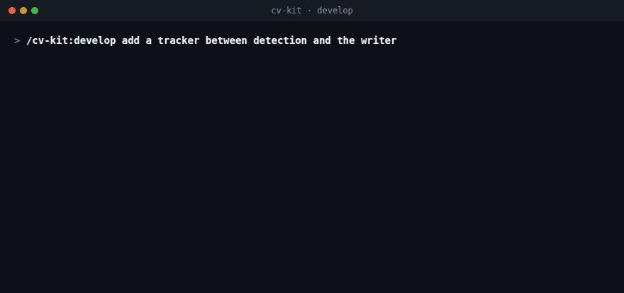
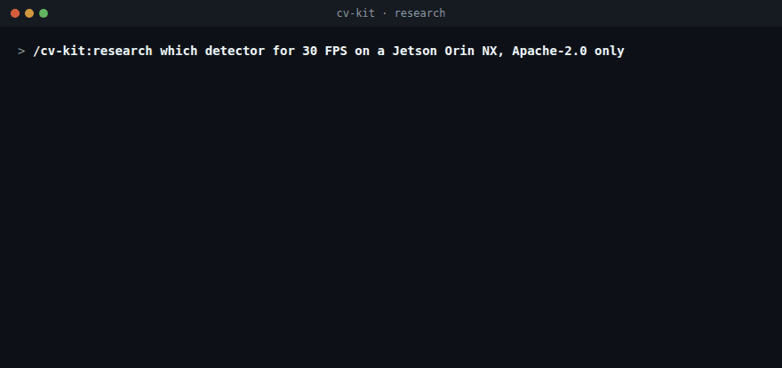

# cv-kit

[](https://github.com/lthphuw/cv-kit/actions/workflows/validate.yml)
[](LICENSE)

A Claude Code plugin for computer-vision engineers who write Python, edge C++ and Go.


<sub>White boxes run on the main thread, blue agents only read, the purple engineer edits code test first, and the yellow notes say when a step runs.</sub>

## What you see

Both recordings are scripted examples, not measured results. The agent rows in them are drawn by the plugin's own
status line, `hooks/agent_status.py`.

### A develop run



<sub>"Add a tracker between detection and the writer": you approve the brief, the explorer finds where frames reach the writer, you approve the architect's two packages, two engineers build them in parallel, and the reviewer reads the diff.</sub>

Nothing is built before your yes on the brief, and on the design when there is one. The run ends with what was
skipped or is at risk, then the results with their evidence, then prompts to paste:

```
● Nothing is committed.
  Summarization:
  - Tracker in vision/track.py, called at pipeline.py:57
  - 9 new tests, each failed first
  - pytest -q: 50 passed   ruff check .: All checks passed!
  - Review: Blocking: 0 Critical, 0 Major
  Next:
  - commit the change
```

### A research run



<sub>"Which detector for 30 FPS on a Jetson Orin NX, Apache-2.0 only": the licence cuts three of six candidates, one researcher reads each of the rest, a verifier re-reads the same sources without seeing the claimed values, and the lint counts the verdicts.</sub>

The chat shows only the Overview and the path. Everything else is on disk, in `research/<slug>/`:

```
research/detector-orin-nx/
├── report.md               what you read: one screen, at most 400 words outside the table
├── appendix.md             exclusions · not found or not checked · caveats · ledger · sources
├── brief.md                task · metric · dataset and split · hardware · latency · licence
├── scout-rf-detr.json      one researcher's evidence, one file per candidate
├── claims.json             every claim: value, verbatim quote, source, locator, label
├── blind.json              the same claims without their values, for the verifiers
├── checks-rf-detr.json     one verifier's verdict per claim, one file per candidate
├── sources/                the saved papers, model cards and READMEs the quotes come from
├── repos/                  clones at a recorded commit, git-ignored, never run
└── evidence/repos.json     url, ref and commit of each clone
```

`report.md` has four parts: Overview, at most 7 key points, the comparison table and at most 3 next steps.

<details>
<summary>Example <code>report.md</code>, with the numbers left out (<code>…</code>)</summary>

```markdown
# Detector: which model for 30 FPS on a Jetson Orin NX, Apache-2.0 only?
2026-11-11, brief 3f9c2ab, cv-kit 0.9.1.

## Overview
Start with RF-DETR-S. No candidate publishes latency on an Orin NX; every FPS figure comes from a T4, so the
30 FPS budget is unconfirmed. Confidence: medium.

## Key points
1. **No latency was measured on the target board**
   All three report T4 TensorRT latency [rf-detr-4] [d-fine-3] [rt-detrv2-2].
2. **One AP has two values**
   Paper and README differ for RT-DETRv2-S [rt-detrv2-3], unconfirmed; both rows are in the table.

## Comparison
| Candidate | Value | Metric | Dataset and split | Resolution | Hardware | Version | Licence    | Claim       |
|-----------|-------|--------|-------------------|------------|----------|---------|------------|-------------|
| RF-DETR-S | …     | AP     | COCO val2017      | …          | n/a      | …       | Apache-2.0 | [rf-detr-2] |
| D-FINE-S  | …     | AP     | COCO val2017      | …          | n/a      | …       | Apache-2.0 | [d-fine-1]  |

## Next steps
1. Benchmark RF-DETR-S and D-FINE-S at FP16 on the Orin NX: FPS at batch 1 on 1,000 val2017 images.

Details, exclusions and sources: [appendix.md](appendix.md).
```

A real report carries the numbers, each with the tag of its claim in `claims.json`.

</details>

A claim's verdict is `confirmed`, `differs`, `wrong-paper`, `absent` or `unreachable`. Only a `confirmed` claim is
cited without the word "unconfirmed", and `scripts/lint_research.py` fails the report otherwise.

### The live rows

One row per agent: `icon agent (model effort) task tokens elapsed`, with `◐` running, `○` stalled, `✓` done,
`✗` failed, `■` killed. When an agent finishes while others still run you get a `Progress` line per agent; a
finished task ends with `Summarization` and `Next`.

## Flows

### `/cv-kit:develop`

```
/cv-kit:develop add a tracker between detection and the writer
  │
  ├─ 1 SIZE ──── one-liner? ─┬─ yes ─► do it inline ─► 5
  │                          └─ no ──► one question at a time ─► brief ─► your yes
  ├─ 2 LOOK ──── project rules · test setup · baseline test run         explorer
  ├─ 3 DESIGN ── only when packages share an interface or a data flow   architect
  │              options · flow · interfaces · packages ─► your yes
  ├─ 4 BUILD ─── red ─► green ─► refactor, one brief per package        engineer × N
  │              independent packages in parallel, each in a worktree
  ├─ 5 VERIFY ── tests + linters ─► review of the pasted diff           reviewer
  └─ 6 REPORT ── cause at path:line · tests by name · literal command output
```

### Who gets the work

```
task ─┬─ find · read · summarise ───────────────► explorer  haiku  ▰▱▱▱▱
      ├─ rename · config · pinned behaviour ────► engineer  sonnet ▰▰▱▱▱
      ├─ known spec · bug a test reproduces ────► engineer  sonnet ▰▰▰▱▱ ─► reviewer sonnet ▰▰▰▱▱
      ├─ packages share an interface or flow ───► architect opus   ▰▰▰▱▱ ─► your yes
      │                                           ─► engineers sonnet ▰▰▰▱▱ ─► reviewer opus ▰▰▰▱▱
      └─ threads · memory · cause unknown ──────► engineer  opus   ▰▰▰▱▱ ─► reviewer opus   ▰▰▰▱▱

came back blocked?   ──► answer it, continue the same agent
failed on the brief? ──► fix the brief, same model
failed on reasoning? ──► sonnet ▰▰▰▱▱ ──► opus ▰▰▰▱▱ ──► opus ▰▰▰▰▱ once ──► report
```

### `/cv-kit:research`

```
/cv-kit:research which detector for 30 FPS on a Jetson Orin NX, Apache-2.0 only
  │
  ├─ 1 FRAME ──────── brief.md: task · metric · split · hardware · latency · licence
  ├─ 2 SCOUT ──────── arXiv · HF Papers · CVF · GitHub ─► one line per candidate
  ├─ 3 SHORTLIST ──── cut by licence ─► task ─► weights ─► traceable numbers ─► your yes (≤ 6)
  ├─ 4 DEEP-READ ──── researcher A   researcher B   researcher C       one per candidate, in parallel
  ├─ 5 CROSS-CHECK ── verifier A     verifier B     verifier C         blind to the claimed values
  │                   lint: confirmed | differs | wrong-paper | absent | unreachable
  └─ 6 REPORT ─────── report.md (overview · ≤ 7 points · table) + appendix.md (ledger · sources)

one claim to check? ─► steps 4–5 only ─► confirmed | partly right | contradicted | not found
```

### `/cv-kit:review` and commits

```
review   scope ─► installed linters and tests ─► reviewer reads the pasted diff ─► findings
         [Critical] CPP-ERR-8 src/infer/engine.cc:88 ─► What · Trigger · Fix
         Blocking: 1 Critical, 0 Major ─► fixes only after your yes

commit   when you ask ─► type(scope): description ─► git / svn commit
                                                         ▲
                                 block_trailers.py ──────┘  refuses AI trailers
```

The commit rule is `rules/commit-vcs.md` (Conventional Commits 1.0.0). `develop` reads it from the plugin; copied into
`.claude/rules/`, it holds in every session.

## Install

```
/plugin marketplace add lthphuw/cv-kit
/plugin install cv-kit@cv-kit

/plugin marketplace update cv-kit     # update
/reload-plugins
```

Needs Claude Code ≥ 2.1.295 and `python3`. `figure` also needs Python ≥ 3.10 and Chrome or Chromium (`CHROME=` if not
on PATH; not the snap build, it cannot read `/tmp`).

## Skills

Name a skill, or describe the work: "NMS crashes on empty input" loads `develop`.

| Kind | Name | Example prompt | You get |
|:-----|:-----|:---------------|:--------|
| Skill | `develop` | `NMS in src/post/nms.cc crashes on zero detections` | failing test → fix → literal `ctest` output |
| | | `set this repo up with strict ruff and mypy` | lint configs and `.claude/rules/` after your yes, existing files kept |
| Skill | `research` | `which detector for 30 FPS on Orin NX, Apache-2.0` | short report, every number re-checked against its source |
| Skill | `review` | `train/val split in data/split.py, any leakage?` | `[Severity] RULE-ID path:line` findings → `Blocking: N Critical, M Major` |
| Skill | `figure` | `low-level figure with tensor shapes for the neck and head` | hand-drawn HTML + PNG (SVG for papers), like the one above |

## Agents

You never pick an agent: the skill does, and sizes the model and effort to the task.

| Kind | Name | Model · effort | Job |
|:-----|:-----|:---------------|:----|
| Agent | `explorer` | haiku `▰▱▱▱▱` | find and summarise code, logs, docs · read-only |
| Agent | `architect` | opus `▰▰▰▱▱` · public API, threading: `▰▰▰▰▱` | options, flow, interfaces, work packages · read-only |
| Agent | `engineer` | sonnet `▰▰▰▱▱` · mechanical: `▰▰▱▱▱` · hard: opus `▰▰▰▱▱` | one change, test first, from a full brief |
| Agent | `reviewer` | sonnet `▰▰▰▱▱` · risky or designed: opus `▰▰▰▱▱` | findings with rule IDs · read-only |
| Agent | `researcher` | sonnet `▰▰▰▱▱` | sourced evidence for one candidate model |
| Agent | `claim-verifier` | haiku `▰▰▱▱▱` | re-reads one candidate's sources, blind to the claimed value |

Effort: `▰▱▱▱▱` low · `▰▰▱▱▱` medium · `▰▰▰▱▱` high · `▰▰▰▰▱` xhigh

- Sonnet is the default. Opus runs for a concurrency or memory-safety bug, a cause still unknown after a
  reproduction attempt, a design, and the review of those.
- Work that splits into packages sharing an interface or a data flow goes to `architect` first, and you approve the
  design before any engineer starts.
- Every engineer gets a written brief: `Goal · Done when · Facts · Files · Constraints · Ruled out · Mode`.
- A failure on the brief gets a fixed brief and the same model. A failure on the reasoning moves from sonnet to opus,
  then to opus `▰▰▰▰▱` once, then to a report. At most three attempts.

## Unattended runs

`/goal <condition>` runs until a judge model says the condition holds; `/loop [interval] <prompt>` repeats. Use auto
mode.

```
/goal follow /cv-kit:develop. clamp_boxes in vision/utils.py clips xyxy boxes and drops empty ones; a new pytest test failed first, then `pytest -q` exits 0 and `ruff check .` is clean. Then /cv-kit:review the diff against main until it ends with `Blocking: 0 Critical, 0 Major`. Print each output. Or stop after 25 turns.
```

```
/loop 15m first run `test -f .cv-kit-stop` and stop if it exists; otherwise /cv-kit:review the diff against main, report only new Critical or Major findings, change nothing
```

- Nothing is committed or pushed unless the condition says so.
- With the `permissions.ask` rules `develop` offers for unattended runs, `git commit`, `git push` and `gh pr create`
  still prompt.
- Two failed fixes stop the run with the evidence; `touch .cv-kit-stop` halts the loop above.

Draft one with `/cv-kit:develop write the /goal line for the NMS crash`. Templates:
`skills/develop/references/goal-loop-templates.md`.

## Hooks

| Hook | Runs | Does |
|:-----|:-----|:-----|
| `concise.py` | session and agent start | short replies; the `Progress`, `Summarization` and `Next` blocks |
| `block_trailers.py` | before each Bash call | refuses a commit that carries an AI trailer |
| `evidence_gate.py` | after edits and Bash, at stop | code changed after the last green test: holds the turn, once |
| `agent_status.py` | status line | the live agent rows |

Details and known gaps: `hooks/README.md`.

## Configuration

| What | Where | How |
|:-----|:------|:----|
| Rules, lint configs | ask `develop` to set the project up | never overwrites; refresh: `python3 scripts/install_rules.py <project> --force` |
| Models | `model:` in `agents/*.md` | aliases `haiku` `sonnet` `opus`, or a full model ID to pin |
| Concise mode, Progress, Next | `hooks/hooks.json` | remove the two `concise.py` entries to turn off |
| Evidence ledger | `~/.cache/cv-kit/gate/` | move with `CV_KIT_GATE_DIR` |
| Live rows | plugin `settings.json` | your own `subagentStatusLine` wins; `NO_COLOR=1` drops colour |

Lint configs tested with ruff 0.17.2, mypy 2.4.0, clang-format and clang-tidy 23.1.3, CMake 4.4, GCC 13.3.

## Limitations

- Evidence gate: a nudge; it cannot tell whether the right tests ran.
- Commit hook: gaps such as `--amend --no-edit` and `bash -c` (`hooks/README.md`).
- Live rows: need the SessionStart hook; off in untrusted folders and under `disableAllHooks`.
- Progress, Summarization, Next: written by the model, which can skip one.
- Catalogue rows marked `UNVERIFIED` are unchecked; licences change.
- No training, benchmark harness or hardware measurement: you run those.
- Cost: in the eval run a session with the plugin cost about twice one without. `architect` and the hard rows of
  `engineer` and `reviewer` run on Opus, and a review of code with threads goes to the Opus reviewer.
- The eval suite calls the API: a full two-sided run is 126 sessions.

## Development

```
python3 -m venv .venv && .venv/bin/pip install -r requirements-dev.txt
.venv/bin/python scripts/validate_plugin.py
.venv/bin/python -m pytest tests -q
claude plugin validate . --strict
```

CI runs the same. Change the plugin test first; run `scripts/run_evals.sh` before a release. How to contribute:
`AGENTS.md`. Reference material: `shared/`, `hooks/README.md`, `evals/README.md`. The overview figure is built from
`docs/figures/cv-kit-overview.figure.js` with the `figure` skill's own scripts, and the two recordings by
`python3 docs/figures/demo_gifs.py` (Chrome and ffmpeg).

## Licence

MIT, see `LICENSE`. Catalogued models carry their own licences; check them before use. `figure` bundles rough.js
4.6.6 (MIT) and the Patrick Hand font (SIL OFL 1.1).

## Acknowledgements

Ideas taken from these projects, rewritten in cv-kit's own words:

- [superpowers](https://github.com/obra/superpowers) (MIT): plugin layout, test-first and verify-before-claiming habits.
- [academic-research-skills](https://github.com/imbad0202/academic-research-skills) (CC BY-NC 4.0, ideas only): the
  blind claim verifier and its verdicts.
- [Deep-Research-skills](https://github.com/Weizhena/Deep-Research-skills) (MIT): the scout and deep-read stages.
- [skill-focus](https://github.com/stephenturner/skill-focus) (MIT): the short FOCUS report (Lin, Nat. Biotechnol. 2025).
- [diagram-design](https://github.com/cathrynlavery/diagram-design) (MIT): the figure rules and checks.
- [ponytail](https://github.com/DietrichGebert/ponytail) (MIT): concise mode.
- [humanizer](https://github.com/blader/humanizer) (MIT) and Wikipedia's
  [Signs of AI writing](https://en.wikipedia.org/wiki/Wikipedia:Signs_of_AI_writing): the plain-prose rules.
- [Conventional Commits 1.0.0](https://www.conventionalcommits.org/en/v1.0.0/) (CC BY 3.0): the commit format.
- Style catalogues: the Google Python and C++ Style Guides (CC BY 3.0), the C++ Core Guidelines, methylDragon's coding
  notes (BSD-2-Clause), the Go documentation (BSD-3-Clause; CC BY 4.0 for site pages), the uber-go guide (Apache-2.0)
  and goleak (MIT, test only).
